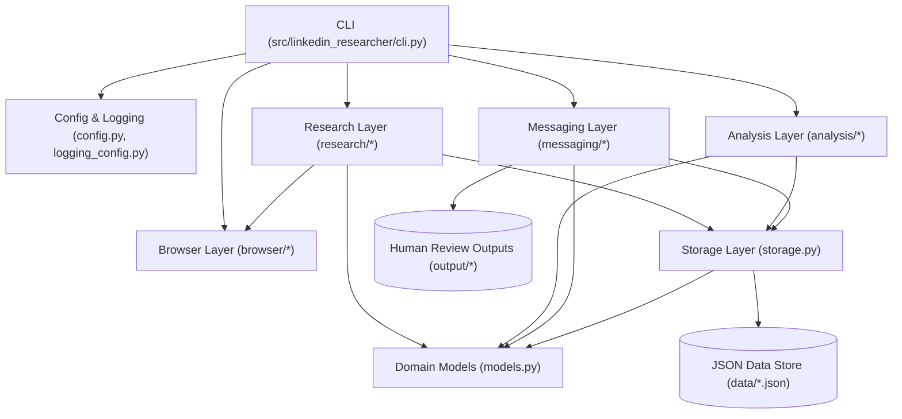

# Arquitetura do Sistema (`docs/ARCHITECTURE.md`)

## 1. Visão Geral

O **LinkedIn Researcher & Career Assistant** é uma ferramenta local e configurável em Python projetada para apoiar a pesquisa de mercado e recolocação profissional de candidatos, com análise explicável de aderência ao currículo e geração de rascunhos de abordagem para revisão humana obrigatória.

O sistema opera sob o princípio de **Human-in-the-Loop (Controle Humano Obrigatório)**:

- **Automatiza (de forma pontual e assistida):** navegação em sessão autenticada autorizada, coleta estruturada de dados profissionais visíveis de recrutadores, confirmação de empresas, localização de vagas, análise explicável de aderência ao currículo e geração de rascunhos de mensagens.
- **Nunca automatiza:** login/MFA/CAPTCHA, envio de mensagens, envio de convites de conexão ou submissão de candidaturas.

---

## 2. Diagrama de Arquitetura Modular

---

## 3. Camadas e Responsabilidades

### 3.1. Configuração e Infraestrutura (`config.py`, `logging_config.py`)

- Carrega variáveis de ambiente via `python-dotenv` com defaults seguros.
- Resolve caminhos usando `pathlib.Path`.
- Configura logs estruturados em console e em `logs/linkedin_researcher.log`, filtrando potenciais dados sensíveis.

### 3.2. Modelos de Domínio (`models.py`)

- Implementados com **Pydantic v2** para validação rigorosa de tipos, datas ISO-8601, URLs e enums de status/aderência.
- Entidades principais:
  - `Recruiter`: dados do recrutador, empresa atual (`company_verified: bool`), foco de recrutamento, contexto profissional, `source_url`, `profile_checked_at`.
  - `Company`: dados verificados da empresa, setor, localização, modelo de trabalho, `source_urls`, `verified_at`.
  - `Job`: dados da vaga, requisitos, responsabilidades, modalidade, faixa salarial, resultado do matching (`match_score`, `match_level`, `strengths`, `gaps`), `application_url`, `checked_at`.
  - `SuggestedMessage`: rascunho vinculado ao `recruiter_id`, contexto utilizado, status de revisão humana (`review_status`), `sent_by_user`, `sent_at`, `reply_status`.

### 3.3. Persistência (`storage.py` e `data/*.json`)

- **Decisão Técnica: JSON vs. SQLite (Seção 4 da Especificação)**
  - **Escolha para o MVP:** **Arquivos JSON estruturados** (`data/recrutadores.json`, `data/empresas.json`, `data/vagas.json`, `data/contatos.json`), com possibilidade de espelhamento opcional ou migração futura para SQLite.
  - **Justificativa:**
    1. A estrutura obrigatória da Seção 5 exige explicitamente os quatro arquivos JSON em `data/`.
    2. O escopo do projeto envolve pesquisa pontual e de baixo volume (iniciando com 8 recrutadores e vagas correlatas), onde arquivos JSON validados por Pydantic oferecem leitura imediata por humanos, fácil inspeção em diffs e zero sobrecarga de migração de schema.
    3. Toda a leitura, escrita atômica (via arquivo temporário + `replace`) e deduplicação (por `id` ou `linkedin_url` / `application_url` normalizada) ficam encapsuladas em `storage.py`. Caso o histórico cresça e demande consultas relacionais complexas, `storage.py` pode passar a usar `sqlite3` mantendo a mesma interface pública.

### 3.4. Automação de Navegador (`browser/`)

- `browser_manager.py`: Gerencia o ciclo de vida do Playwright assíncrono (`playwright.async_api`) e o `BrowserContext` persistente em diretório local dedicado (`.playwright-profile/`).
- `session_manager.py`: Conduz o fluxo de login manual interativo (`browser login`), verifica se a sessão está autenticada e detecta bloqueios/CAPTCHA/MFA para pausar e solicitar ação humana.
- `linkedin_pages.py`: Encapsula a navegação e os seletores semânticos resilientes para extração de dados de perfis de recrutadores, páginas de empresas e detalhes de vagas. Não contém regras de negócio de matching nem geração de texto.

### 3.5. Pesquisa e Normalização (`research/`)

- `recruiter_research.py`: Coordena a consulta ao perfil de um recrutador, separa fatos observados de inferências e atualiza o registro em `data/recrutadores.json`.
- `company_research.py`: Verifica vínculo atual e dados da empresa em `data/empresas.json`.
- `job_research.py`: Pesquisa e extrai vagas com registro obrigatório de `source_urls`, `published_at` e `checked_at`.

### 3.6. Análise e Matching (`analysis/`)

- `curriculum_profile.py`: Representa o perfil profissional estruturado e configurável do candidato a partir de `data/perfil_candidato.json` e dos documentos em `curriculum/`.
- `job_matching.py`: Compara requisitos e responsabilidades da vaga com o perfil ativo do candidato em 7 dimensões (atividades, senioridade, ferramentas, modalidade, contratação, localização, salário), classificando em **Alta**, **Média** ou **Baixa** aderência com justificativa explicável (`strengths` e `gaps`).
- `ranking.py`: Filtra e ordena vagas avaliadas conforme prioridade da candidata.

### 3.7. Geração de Mensagens (`messaging/`)

- `message_generator.py`: Constrói rascunhos personalizados em primeira pessoa combinando networking e interesse em oportunidades, adaptados ao contexto verificado do recrutador. Salva em `output/mensagens/` e em `data/contatos.json` apenas para revisão humana.

### 3.8. Arquitetura Desacoplada de Provedores de LLM (`src/linkedin_researcher/llm/`)

- **Provedor Padrão Local (Ollama):** Inferência 100% privada e local no hardware do usuário (`qwen2.5:3b` recomendado para notebooks com 16 GB RAM / 2 GB VRAM), utilizando structured outputs nativos (`format=schema.model_json_schema()`).
- **Alternância Simples via Configuração:**
  - `LLM_PROVIDER=ollama`: execução local sem envio de dados para a nuvem.
  - `LLM_PROVIDER=gemini`: integração com a Gemini API via SDK `google-genai` (`gemini-3.8-flash` ou `gemini-1.5-pro`).
  - `LLM_PROVIDER=offline`: regras heurísticas determinísticas locais (0 tokens).
- **Travas de controle de uso e quota:**
  1. **Pré-filtro determinístico local (0 tokens):** Cargos excluídos nas preferências do candidato são descartados localmente antes de qualquer chamada a modelos.
  2. **Cache persistente em `data/`:** Vagas já analisadas ou rascunhos já gerados não disparam novas inferências, salvo com `--refresh`.
  3. **Teto por execução (`LLM_MAX_CALLS_PER_RUN`):** Limita o número máximo de chamadas em uma única execução (padrão: `5`).
  4. **Fallback determinístico offline:** Caso o Ollama esteja offline ou o modelo não tenha sido baixado (ou caso a chave do Gemini não esteja configurada), o sistema opera 100% offline com templates e regras locais, garantindo que testes e comandos CLI nunca quebrem.
